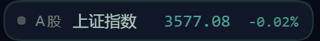
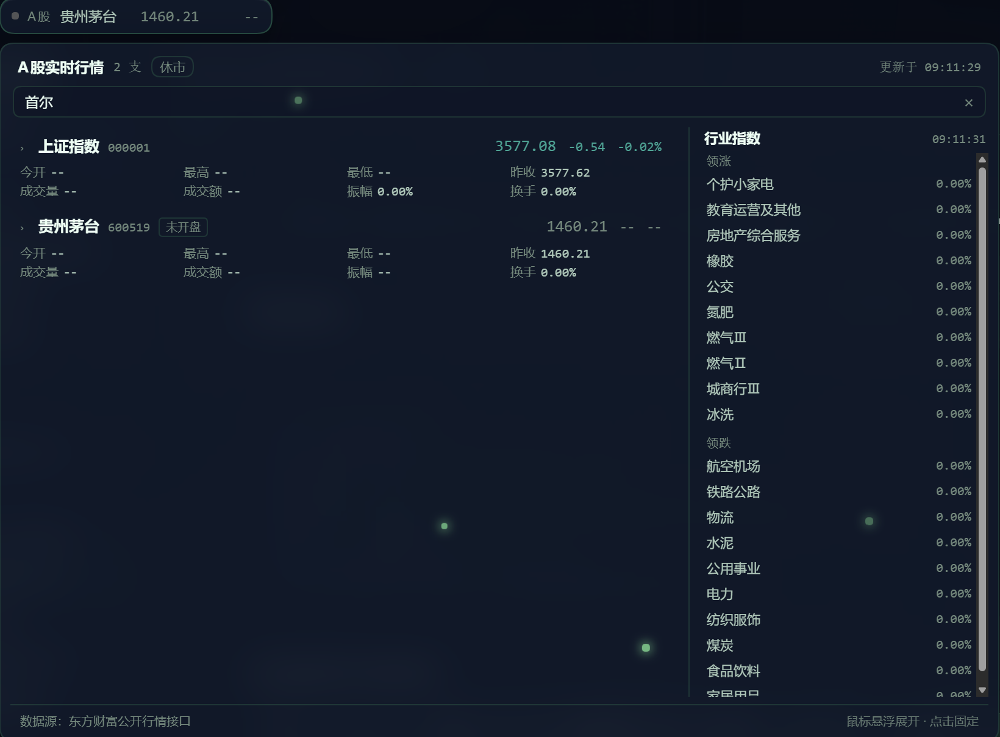

# A-Share Quote Ticker · DSH Plugin

> A compact real-time A-share quote ticker for the [DeepSeek Harness](https://github.com/deepseek-ai) Web UI. It sits in the title-bar strip, rotates **one symbol at a time**, expands into a full quote panel with industry boards on hover, and opens a **Tonghuashun-style intraday chart** when you click a row.

[中文](README.md) · [Changelog](CHANGELOG.md) · [Contributing](CONTRIBUTING.md)

[](https://github.com/Guozifan7/dsh-a-stock-ticker/actions/workflows/test.yml)




## Features

- **Compact ticker pill**
  - Docks in the title-bar strip (four corners available) and rotates vertically: one symbol for 1–15 s, then the next slides up; the last row repeats the first for a seamless loop.
  - Shows `name price change%` on a single line, red for up / green for down (A-share convention), tabular numerals so digits never jitter. Before the open it falls back to the previous close and tags the row.
  - Pulsing green dot while the market is live, red dot on request failure. Turning it off hides the pill and stops all background requests.
- **Hover panel**
  - Left column: every field of every monitored quote — last, change, change %, open, high, low, previous close, volume, amount, amplitude, turnover.
  - Right column: **industry indices** (Eastmoney industry boards, top 10 gainers and losers with a magnitude bar).
  - A 7px hover buffer keeps the panel open while the pointer crosses from pill to panel; clicking the pill pins it (`Esc` closes).



- **Intraday chart (Tonghuashun style)**
  - Click any row to expand the session chart below it; click again to collapse, click another row to switch.
  - Symmetric percent grid **centred on the previous close** (0.5%–20% steps picked automatically), price labels on the left, percent labels on the right, a white price line, an orange VWAP line and a volume pane.
  - The time axis is fixed to 09:30–15:00, so the rest of the session stays blank; `1m / 5m` candlestick views are one click away.
- **Name search**
  - The settings page and the panel each have a search box that matches by **name or code**, instantly and offline, using an embedded catalogue of A-shares, indices and ETFs.
  - Picking from the settings box adds a permanent watch entry; picking in the panel opens a temporary "quick look" row that is polled but never persisted.

## Install

Requires a DeepSeek Harness installation (desktop app or `dsh web`).

```bash
git clone https://github.com/<your-name>/dsh-a-stock-ticker.git
```

Then, in a DSH session, install the local directory:

```
plugin_manager(action: "install_bundle", target: "<absolute-path>/dsh-a-stock-ticker")
```

Or add it to your profile `package.json` as a dependency and register `dsh-a-stock-ticker` in `dsh.profile.bundles` (equivalent to `pnpm add <dir>`).

Afterwards open **Settings → A-Share Quotes** to configure it; refresh the page with `Ctrl+R` if the UI has not picked up the new bundle.

## Usage

1. Settings → **A-Share Quotes**: type a name or code (`茅台`, `600519`, `沪深300`), pick with `↑↓` + `Enter`, or paste several six-digit codes. Adjust the refresh rate (2–60 s), rotation interval (1–15 s) and docked corner.
2. Hover the pill to open the panel; click a row for its intraday chart.
3. The panel search box shows any symbol temporarily — clear it with one click.

### Symbol formats

| Input | Resolved as |
| --- | --- |
| `600519` | Shanghai (6/7 prefix inferred) |
| `000001` / `300750` | Shenzhen (0/3 prefix) |
| `430047` / `920002` | Beijing (4/8/92 prefix) |
| `sh600519` / `600519.SH` | explicit prefix, any case |
| `sh000001` / `sz399001` | indices need the prefix (`000001` means the Shenzhen stock) |

## Data & requests

| Purpose | Upstream | Refresh |
| --- | --- | --- |
| Quotes | `push2.eastmoney.com/api/qt/ulist.np/get` | configured (default 5 s); 60 s when the market is closed; paused while the tab is hidden |
| Industry boards | `push2.eastmoney.com/api/qt/clist/get?fs=m:90+t:2` | every 15 s while the panel is open |
| Intraday candles | `push2his.eastmoney.com/api/qt/stock/kline/get?klt=1` | every 15 s while a chart is open |

- The browser tries the bundle's **same-origin proxy first** (`/api/stockTicker/{quotes,sectors,kline}`, registered on DSH's Fetch registry behind the Host/Origin fence and the browser-session cookie) and falls back to a direct call, since the upstream allows CORS.
- Market phases use `Asia/Shanghai`: 09:15–09:30 call auction, 09:30–11:30 and 13:00–15:00 trading, otherwise closed; weekends are closed. Nothing is requested while closed; the auction keeps refreshing.
- Settings live in `localStorage` under `dsh-a-stock-ticker/settings/v1`, per browser.

> Quotes come from public, unofficial Eastmoney endpoints, for personal study only — **not investment advice**. If those endpoints change, the field tables in `client.js` / `index.js` need updating.

## Layout

```
dsh-a-stock-ticker/
├─ index.js            # Host half: three same-origin proxy routes
├─ client.js           # Client half: ticker + hover panel + settings page (embedded catalogue)
├─ cordis.patch.yml    # bundle layer: inserts the plugin row
├─ locale/{zh,en}.json # plugin-manager title and description
├─ icon.svg            # plugin icon
├─ scripts/build-symbols.mjs  # regenerates the embedded catalogue
├─ test/harness.mjs    # test suite (ships a tiny React runtime)
└─ docs/               # screenshots and release notes
```

- The client mounts two slots: `shell.overlay` (frame-wide floating layer, the ticker, `order: 60`) and `settings.section` (settings page, `order: 26`).
- `client.js` is a **build-free classic script** (`window.__ModuleLoader__.load`) that only needs `react` from the browser module table; every timer, listener and injected stylesheet is registered inside `ctx.effect` or component effects and disposed with them.

## Development

```bash
# regenerate the embedded catalogue (SH/SZ/BJ A-shares + indices + ETFs, ~7,700 entries)
node scripts/build-symbols.mjs

# local test suite (ships a tiny React runtime; covers parsing, polling, rendering, row switching, charts)
node test/harness.mjs      # 221 checks
```

Editing `client.js` only needs a page refresh; editing `index.js` (the Host half) needs a DSH restart.

## Known limitations

- A-shares (SH/SZ/BJ), indices and exchange-traded funds only; no HK/US support.
- The title-bar dock offsets (left 158px / right 152px) are tuned for the DSH desktop window layout; switch corners in settings or adjust the `.ast-layer[data-corner=...]` values if another locale or theme overlaps them.
- The intraday chart is drawn from minute closes; a sealed limit session renders as a flat line tagged "flat", which is the real quote rather than a rendering error.
- The upstream endpoints may rate-limit or change; there is no local cache or retry backoff (failures are surfaced in the UI).

## License

[MIT](LICENSE). Market data belongs to Eastmoney; this project only displays it.
