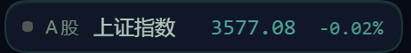
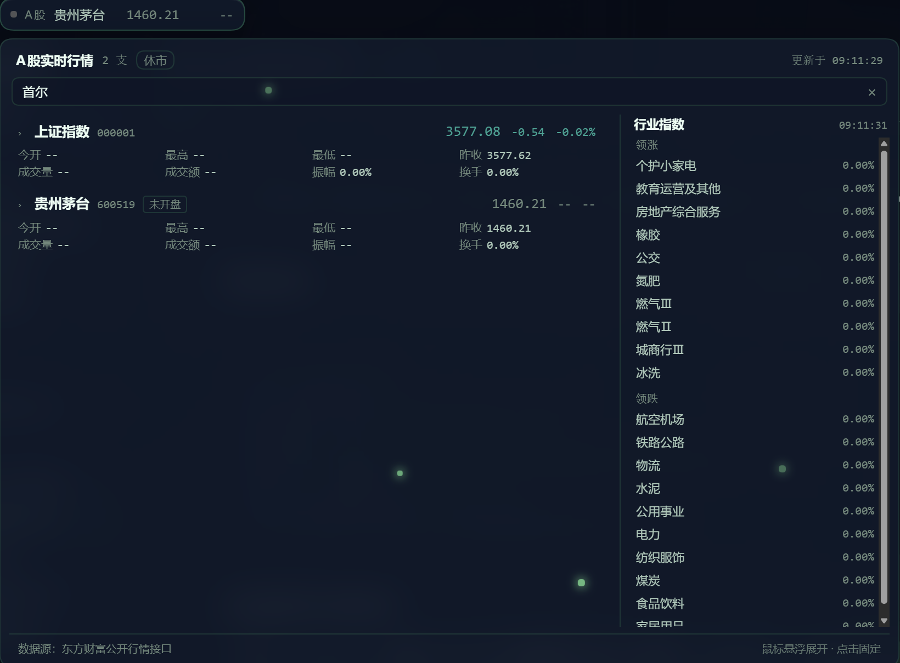
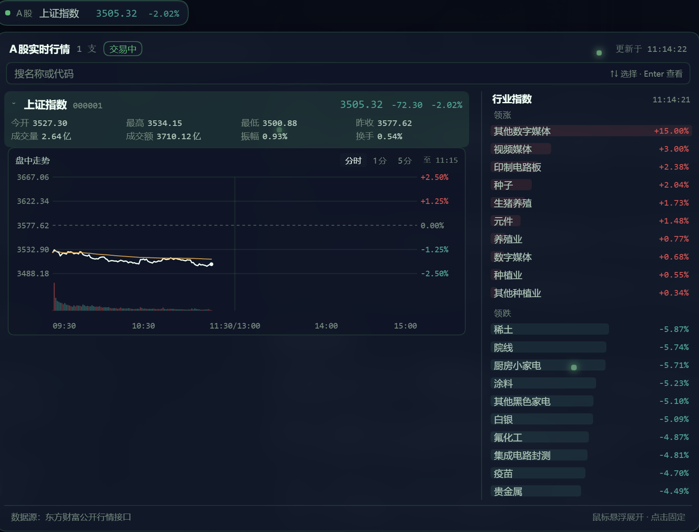
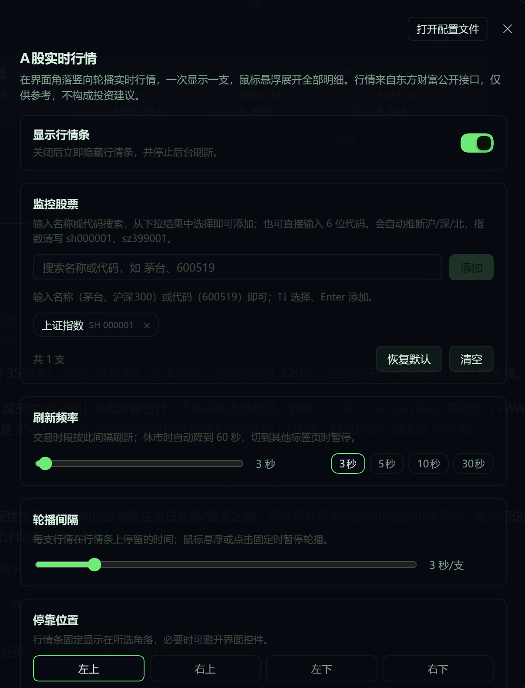

# A股实时行情 · DSH 插件

> 在 [DeepSeek Harness](https://github.com/deepseek-ai) Web 界面左上角常驻一条窄行情条：**竖向轮播、一次一支**，鼠标悬浮展开全部行情与行业指数，**点个股直接看同花顺式盘中分时图**。

[English](README.en.md) · [更新日志](CHANGELOG.md) · [参与贡献](CONTRIBUTING.md)

[](https://github.com/Guozifan7/dsh-a-stock-ticker/actions/workflows/test.yml)




## 功能

- **紧凑行情条**
  - 停靠在标题栏空白带（可切四个角），竖向轮播：每支停留 `1–15 秒`（可调）后向上滑出下一支，末支接首支无缝循环。
  - 单行显示 `名称 现价 涨跌幅`，红涨绿跌，等宽数字不跳动；未开盘时回落显示昨收并标记「未开盘」。
  - 交易时段绿点脉冲，取数失败转红点；关闭开关即隐藏并停止后台请求。
- **悬浮面板**
  - 左栏：每支股票的全字段——现价、涨跌、涨跌幅、今开、最高、最低、昨收、成交量、成交额、振幅、换手率。
  - 右栏：**行业指数**（东方财富行业板块，领涨 / 领跌各 10 个，带涨跌幅与幅度色条）。
  - 面板自带 7px 上方缓冲区，鼠标从胶囊移入面板不会闪断；点击胶囊可固定（`Esc` 收起）。



- **盘中分时图（同花顺样式）**
  - 点击任意个股行 → 该行下方展开当日分时；再点收起，点别的行则切换。
  - 以**昨收为中轴**的对称百分比网格（自动选 0.5%–20% 一档）、左侧价格 / 右侧涨跌幅、白色价格线 + 橙色均价线（VWAP）、下方成交量柱。
  - 时间轴固定 09:30–15:00，未走完的部分留白；另可切 `1分 / 5分` 蜡烛视图。



- **名称搜索**
  - 设置页与面板各有一个搜索框，按**名称或代码**即时匹配（内置 A 股 / 指数 / ETF 名录，断网可用）。
  - 设置页选中 → 加入监控列表并持久化；面板选中 → 加入「临时查看」，实时显示，不写监控列表。
- **设置页（设置 → A股行情）**
  - 显示开关、监控列表增删、刷新频率（2–60 秒）、轮播间隔（1–15 秒/支）、停靠角落（四个角）、运行状态与手动刷新。



## 安装

要求：DeepSeek Harness **≥ 0.2.2-rc.3**（`engines.dsh` 已声明，低版本会被拒绝安装）。

三种方式任选其一。

### 1. 一条命令（推荐）

```powershell
dsh plugin --profile desktop add github:Guozifan7/dsh-a-stock-ticker
```

把 `desktop` 换成你的 profile 名（网页版通常是 `web`）。装完刷新页面。

### 2. 在 DSH 的「发现」里搜索安装

DSH 内置的插件市场是**索引驱动**的：插件 → 更多 → 实验性插件 → 打开「**自定义插件索引**」，然后在「**发现**」标签页 → **添加索引源**，填入：

```
https://cdn.jsdelivr.net/gh/Guozifan7/dsh-a-stock-ticker@main/docs/market/index.json
```

之后搜「A股」即可看到本插件并一键安装（索引文件为 [docs/market/index.json](docs/market/index.json)，任何人都可以添加）。

### 3. 本地目录（开发用）

```powershell
git clone https://github.com/Guozifan7/dsh-a-stock-ticker.git
```

在 DSH 会话里让 Agent 安装该目录：

```
plugin_manager(action: "install_bundle", target: "<绝对路径>/dsh-a-stock-ticker")
```

装好后：**设置 → A股行情** 即可配置；标题栏出现行情条。若界面没更新，`Ctrl+R` 刷新一次页面。

## 使用

1. 设置 → **A股行情**：
   - 「监控股票」输入名称或代码（如 `茅台`、`600519`、`沪深300`），`↑↓` 选择、`Enter` 添加；也可直接粘贴多个 6 位代码。
   - 调刷新频率（2–60 秒）、轮播间隔（1–15 秒/支）、停靠角落。
2. 鼠标移到行情条 → 展开面板；点任意一行 → 展开盘中分时图。
3. 面板顶部搜索框可临时查看任意股票，看完全部点「清空」。

### 代码格式

| 输入 | 解析 |
| --- | --- |
| `600519` | 沪市（6/7 开头自动推断） |
| `000001` / `300750` | 深市（0/3 开头） |
| `430047` / `920002` | 北交所（4/8/92 开头） |
| `sh600519` / `600519.SH` | 显式前缀，大小写不限 |
| `sh000001` / `sz399001` | 指数请写前缀（`000001` 默认按深市个股解析） |

## 数据与请求

| 用途 | 上游接口 | 刷新 |
| --- | --- | --- |
| 个股行情 | `push2.eastmoney.com/api/qt/ulist.np/get` | 设置值（默认 5s）；休市降为 60s；标签页隐藏时暂停 |
| 行业板块 | `push2.eastmoney.com/api/qt/clist/get?fs=m:90+t:2` | 面板展开时每 15s |
| 分钟 K 线 | `push2his.eastmoney.com/api/qt/stock/kline/get?klt=1` | 图表展开时每 15s |

- 浏览器端**优先走同源代理**（`/api/stockTicker/{quotes,sectors,kline}`，由 Host 半侧注册在 DSH 的 Fetch 路由表上，已带 Host/Origin 校验与浏览器会话 Cookie）；代理不可用时自动直连上游（上游对浏览器放开 CORS）。
- 市场阶段按 `Asia/Shanghai` 判断：09:15–09:30 集合竞价、09:30–11:30 与 13:00–15:00 交易、其余休市；周末休市。休市不请求，集合竞价照常刷新。
- 设置保存在浏览器 `localStorage` 的 `dsh-a-stock-ticker/settings/v1`，按浏览器生效。

> 行情来自东方财富公开接口（非官方 SDK），仅供个人学习与参考，**不构成投资建议**；接口字段若变更需要同步调整 `client.js` / `index.js` 中的字段表。

## 结构

```
dsh-a-stock-ticker/
├─ index.js            # Host 半侧：3 个同源代理路由
├─ client.js           # Client 半侧：行情条 + 悬浮面板 + 设置页（内嵌股票名录）
├─ cordis.patch.yml    # bundle 层：插入插件行
├─ locale/{zh,en}.json # 插件管理器里的标题与说明
├─ icon.svg            # 插件图标
├─ scripts/build-symbols.mjs  # 重新生成内嵌名录
├─ test/harness.mjs    # 测试套件（自带迷你 React 运行时）
└─ docs/               # 截图与 GitHub 发布信息
```

- Client 挂载两个插槽：`shell.overlay`（框架级浮层，行情条，`order: 60`）与 `settings.section`（设置页，`order: 26`）。
- `client.js` 是**无构建**的经典脚本（`window.__ModuleLoader__.load`），只依赖浏览器模块表里的 `react`；所有定时器、监听器与注入的样式都在 `ctx.effect`/组件 effect 中注册并清理。

## 开发

```bash
# 重新生成内嵌股票名录（沪深京 A 股 + 指数 + ETF，约 7,700 条）
node scripts/build-symbols.mjs

# 本地测试（自带一个极简 React 运行时，覆盖解析/轮询/渲染/切换行/分时绘制）
node test/harness.mjs      # 221 项
```

改完 `client.js` 只需刷新页面即可生效；改 `index.js`（Host 半侧）需要重启 DSH。

## 已知限制

- 仅支持 A 股（沪深京）、指数与场内 ETF；港股/美股未适配。
- 标题栏停靠的左右偏移（左 158px / 右 152px）按 DSH 桌面版窗口菜单与按钮位置调校，换语言或改主题后若发生遮挡，可在设置里换角落，或改 `client.js` 中 `.ast-layer[data-corner=...]` 的数值。
- 分时图按分钟收盘价绘制；一字板会画成一条水平线并标注「一字」，这是真实行情而非渲染错误。
- 第三方接口可能限频或变更，插件不做本地缓存与重试退避（只有失败提示）。

## 许可证

[MIT](LICENSE)。行情数据版权归东方财富所有，本项目仅做展示。
